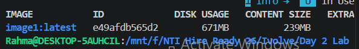
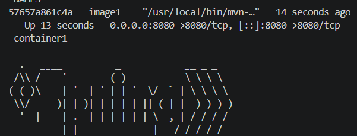
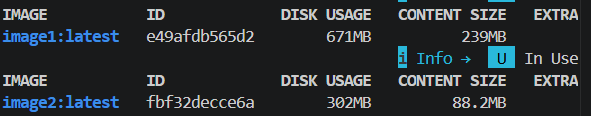
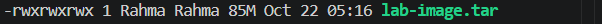

# Lab 4: Docker Image Optimization and Export/Load

## Objective
Reduce the size of a Docker image using a multi-stage build, run the application as a non-root user, and move the image between hosts with `docker save` and `docker load`.

Source code: https://github.com/Ibrahim-Adel15/ImageOptimization-.git

## Prerequisites
- WSL2, Docker, Git

## Project Structure
```text
Lab4/
├── ImageOptimization/
│   ├── Dockerfile            # multi-stage, non-root (image2)
│   ├── Dockerfile.original   # original single-stage (image1)
│   ├── pom.xml
│   └── src/
├── Screenshots/
└── README.md
```

## Step 1: Build image1 from the original Dockerfile
```bash
git clone https://github.com/Ibrahim-Adel15/ImageOptimization-.git ImageOptimization
cd ImageOptimization
docker build -t image1 .
docker images image1
```
Size: **671 MB**



## Step 2: Run and verify container1
```bash
docker run -d --name container1 -p 8080:8080 image1
docker ps
curl http://localhost:8080
```


## Step 3: Stop and delete container1
```bash
docker stop container1
docker rm container1
docker ps -a
```

## Step 4: Multi-stage Dockerfile (non-root)
```dockerfile
# Stage 1: build
FROM maven:3.9.15-eclipse-temurin-17-alpine AS build
WORKDIR /app
COPY pom.xml .
COPY src ./src
RUN mvn package -DskipTests

# Stage 2: runtime
FROM eclipse-temurin:17-jre-alpine
RUN addgroup -S appgroup && adduser -S appuser -G appgroup
WORKDIR /app
COPY --from=build --chown=appuser:appgroup /app/target/demo-0.0.1-SNAPSHOT.jar app.jar
USER appuser
EXPOSE 8080
CMD ["java", "-jar", "app.jar"]
```

## Step 5: Build image2 and compare sizes
```bash
docker build -t image2 .
docker images image2
```

| Image | Approach | Disk usage | Content size |
|-------|----------|-----------|--------------|
| image1 | Single stage (Maven + JDK) | 671 MB | 239 MB |
| image2 | Multi-stage, JRE Alpine, non-root | 302 MB | 88.2 MB |

image2 is about **55% smaller** on disk (369 MB saved).



## Step 6: Run container2 and verify non-root
```bash
docker run -d --name container2 -p 8080:8080 image2
docker exec container2 whoami
docker exec container2 id
```
`whoami` prints `appuser`, so the application does not run as root.


## Step 7: Stop and delete container2
```bash
docker stop container2
docker rm container2
docker ps -a
```

## Step 8: Save image2 as a TAR file
```bash
docker save -o lab-image.tar image2
ls -lh lab-image.tar
```


## Step 9: Delete image2 and load it back
```bash
docker rmi image2
docker images image2
docker load -i lab-image.tar
docker images image2
```
The image disappeared after `docker rmi` and was restored by `docker load`.


## Why image2 is smaller
- Build tools (Maven, JDK, source code, dependency cache) stay in stage 1 and are discarded.
- The final stage contains only a JRE on Alpine and the finished JAR.
- Fewer packages also means a smaller attack surface.

## Notes
- The lab text says `lab-image.tar` in one step and `image2.tar` in another. `lab-image.tar` was used for both.
- `lab-image.tar` is not committed to Git because of its size (it is in `.gitignore`).