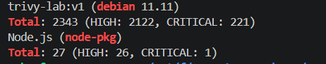
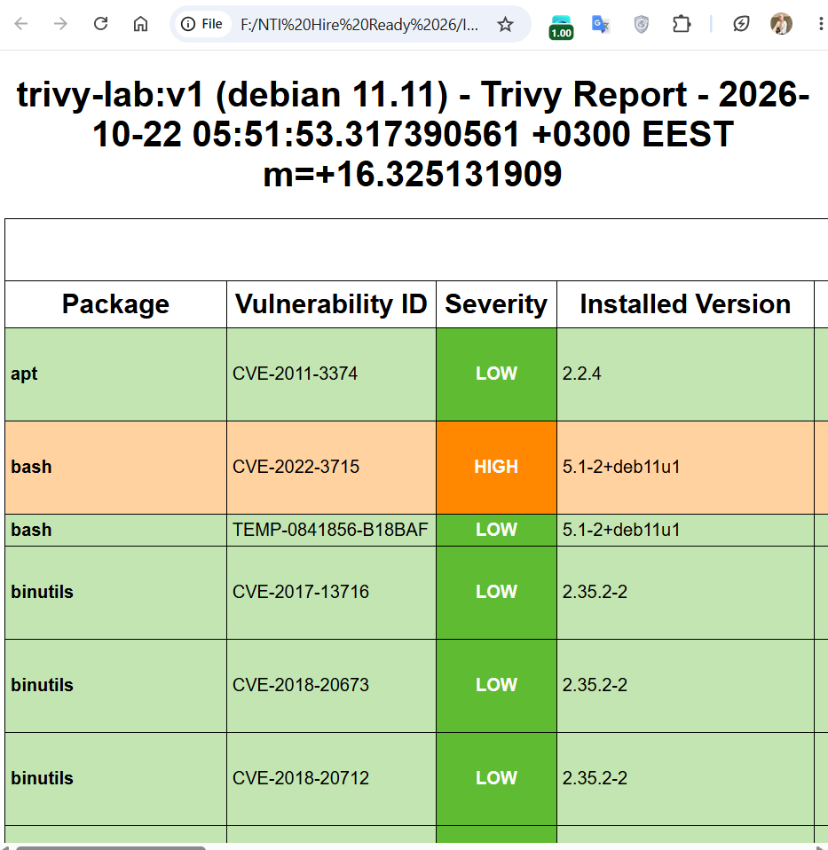
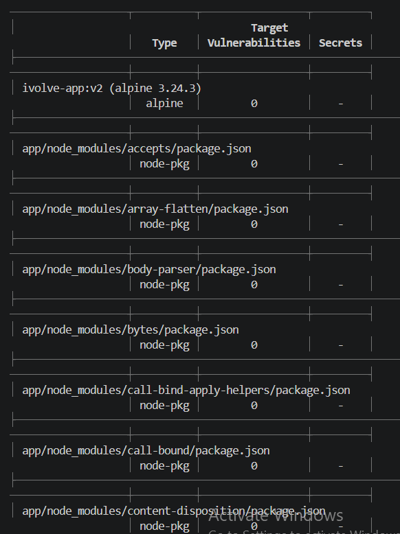

# Lab 5: Docker Image Vulnerability Scanning with Trivy

## Objective
Scan a Docker image for vulnerabilities with Trivy, generate HTML reports, and remediate the HIGH and CRITICAL findings.

Source code: https://github.com/Ibrahim-Adel15/TrivyImage.git

## Prerequisites
- WSL2, Docker, Trivy

## Project Structure
```text
Lab5/
├── TrivyImage/
│   ├── Dockerfile            # fixed version (ivolve-app:v2)
│   ├── Dockerfile.original   # original version (trivy-lab:v1)
│   ├── package.json
│   └── app.js
├── reports/
│   ├── report-v1.html
│   └── report-v2.html
├── templates/
│   └── html.tpl              # Trivy HTML report template
├── Screenshots/
└── README.md
```

## Part 1: Build the original image

**Original Dockerfile** (`Dockerfile.original`)
```dockerfile
FROM node:18-bullseye
WORKDIR /app
COPY package.json ./
RUN npm install
COPY app.js ./
EXPOSE 3000
CMD ["npm", "start"]
```

```bash
cd TrivyImage
docker build -t trivy-lab:v1 .
docker images trivy-lab:v1
```

## Part 2: Install Trivy

```bash
sudo apt-get update
sudo apt-get install -y wget gnupg
wget -qO - https://aquasecurity.github.io/trivy-repo/deb/public.key | gpg --dearmor | sudo tee /usr/share/keyrings/trivy.gpg > /dev/null
echo "deb [signed-by=/usr/share/keyrings/trivy.gpg] https://aquasecurity.github.io/trivy-repo/deb generic main" | sudo tee /etc/apt/sources.list.d/trivy.list
sudo apt-get update
sudo apt-get install -y trivy

trivy --version
```

## Part 3: Scan the image

**Full scan**
```bash
trivy image trivy-lab:v1
```


**Only HIGH and CRITICAL**
```bash
trivy image --severity HIGH,CRITICAL trivy-lab:v1
```

**HTML report**

Trivy's HTML template is not installed by `apt`, so it was downloaded from the Trivy repository:
```bash
cd ..
mkdir -p templates reports
wget -O templates/html.tpl https://raw.githubusercontent.com/aquasecurity/trivy/main/contrib/html.tpl
trivy image --format template --template "@templates/html.tpl" -o reports/report-v1.html trivy-lab:v1
```


## Findings (v1)

- The base image `node:18-bullseye` is Debian 11 with Node 18, both outdated.
- OS findings came from packages the app does not need (for example python3.9, util-linux, wget, zlib1g).
- Node findings came from `express` dependencies (`body-parser`, `path-to-regexp`) and from npm's own bundled packages (`tar`, `glob`, `minimatch`, `cross-spawn`, and others).
- Some findings have no fix yet (`will_not_fix`, `fix_deferred`, `affected`). The lab asks to fix only issues where a fix is available.

## Bonus: Vulnerability Remediation

**Changes**

| | v1 (original) | v2 (fixed) |
|---|---|---|
| Base image | `node:18-bullseye` (Debian 11) | `node:22-alpine` |
| npm | bundled with the old image | `npm install -g npm@latest` |
| express | old version | `^4.22.3` |
| Install | `npm install` | `npm install --omit=dev` |

**Fixed Dockerfile**
```dockerfile
FROM node:22-alpine
WORKDIR /app
COPY package*.json ./
RUN npm install --omit=dev
RUN npm install -g npm@latest
COPY app.js ./
EXPOSE 3000
CMD ["npm", "start"]
```

**Rebuild and rescan**
```bash
cd TrivyImage
docker build -t ivolve-app:v2 .
trivy image --severity HIGH,CRITICAL --ignore-unfixed ivolve-app:v2
cd ..
trivy image --severity HIGH,CRITICAL --ignore-unfixed --format template --template "@templates/html.tpl" -o reports/report-v2.html ivolve-app:v2
```


**Application check**
```bash
docker run -d --name test-v2 -p 3000:3000 ivolve-app:v2
curl http://localhost:3000
docker rm -f test-v2
```
The application responds correctly after the changes.

## Results

The v2 report (`ivolve-app:v2`, Alpine 3.24.3) shows **no vulnerabilities** in either the Alpine OS packages or the Node.js packages.
The v2 image is about 78% smaller (1.46 GB to 315 MB) and has no fixable HIGH or CRITICAL vulnerabilities.

## Conclusion
Updating the base image and the dependencies removed all fixable HIGH and CRITICAL vulnerabilities. A smaller base image such as Alpine also means fewer packages to patch and a smaller attack surface.

## Notes
- The slide tags the