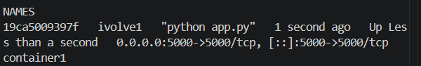
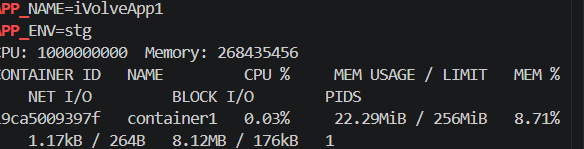

# Lab 6: Docker Environment Variables and Resource Management

## Objective
Run a Python application in Docker, configure it with environment variables in three different ways, and limit the container's CPU and memory.

Source code: https://github.com/Ibrahim-Adel15/PythonApp.git

## Prerequisites
- WSL2, Docker, Git

## Project Structure
```text
Lab6/
├── PythonApp/
│   ├── Dockerfile
│   ├── app.py
│   ├── requirements.txt
│   └── env.txt
├── Screenshots/
└── README.md
```

## Concepts

| Method | Syntax | Use case |
|---|---|---|
| Single variable at run time | `-e KEY=value` | A few quick overrides |
| File | `--env-file env.txt` | Many variables, one file per environment |
| Baked into the image | `ENV KEY=value` in the Dockerfile | Default values |

**Priority:** values passed with `docker run` override `ENV` values from the Dockerfile.

## Step 1: Dockerfile and image (ivolve1)

```dockerfile
FROM python:3.12-slim
WORKDIR /app
COPY requirements.txt .
RUN pip install --no-cache-dir -r requirements.txt
COPY . .
EXPOSE 5000
CMD ["python", "app.py"]
```

```bash
docker build -t ivolve1 .
```

## Step 2: container1 with variables and resource limits

```bash
docker run -d --name container1 -p 5000:5000 \
  -e APP_NAME=iVolveApp1 -e APP_ENV=stg \
  --cpus="1" --memory="256m" \
  ivolve1
curl http://localhost:5000
```
Application response: `___`



## Step 3: Verify variables, limits and usage

```bash
docker exec container1 env | grep APP_
docker inspect container1 --format 'CPU: {{.HostConfig.NanoCpus}}  Memory: {{.HostConfig.Memory}}'
docker stats --no-stream container1
```

| Setting | Value |
|---|---|
| APP_NAME | iVolveApp1 |
| APP_ENV | stg |
| CPU limit | 1 CPU (`NanoCpus = 1000000000`) |
| Memory limit | 256 MB (`Memory = 268435456`) |

`docker stats` shows the memory limit in the `MEM USAGE / LIMIT` column.



## Step 4: container2 with an env file

```bash
docker rm -f container1

cat > env.txt <<'EOF'
APP_NAME=iVolveApp2
APP_ENV=prod
EOF

docker run -d --name container2 -p 5000:5000 --env-file env.txt ivolve1
curl http://localhost:5000
docker exec container2 env | grep APP_
```
The variables were loaded from `env.txt`: `APP_NAME=iVolveApp2`, `APP_ENV=prod`.


## Step 5: Variables hardcoded in the Dockerfile (ivolve2)

Two lines were added after `WORKDIR /app`:
```dockerfile
ENV APP_NAME=iVolveApp3
ENV APP_ENV=dev
```

```bash
docker rm -f container2
docker build -t ivolve2 .
docker run -d --name container2 -p 5000:5000 ivolve2
curl http://localhost:5000
docker exec container2 env | grep APP_
```
Result: `APP_NAME=iVolveApp3`, `APP_ENV=dev`.


## Step 6: Priority check (extra)

```bash
docker rm -f container2
docker run -d --name container2 -p 5000:5000 -e APP_ENV=prod ivolve2
docker exec container2 env | grep APP_
```

| Variable | Dockerfile value | Final value |
|---|---|---|
| APP_NAME | iVolveApp3 | iVolveApp3 |
| APP_ENV | dev | **prod** |

`-e` at run time overrides `ENV` from the Dockerfile, and untouched variables keep the image default.


## Clean up
```bash
docker rm -f container2
```

## Summary

| Container | Image | Variables from | APP_NAME | APP_ENV | Limits |
|---|---|---|---|---|---|
| container1 | ivolve1 | `-e` flags | iVolveApp1 | stg | 1 CPU, 256 MB |
| container2 | ivolve1 | `--env-file env.txt` | iVolveApp2 | prod | none |
| container2 | ivolve2 | `ENV` in Dockerfile | iVolveApp3 | dev | none |

## Notes
- The slide says `docker stats cont1`, but the container is named `container1`, so that name was used.
- The slide reuses the name `container2` for the last run, so the previous container2 was removed first.
- The slide does not name the last image, so `ivolve2` was used.
- Containers 1 and 2 use the same host port 5000, so only one runs at a time.
- Secrets should not be hardcoded with `ENV`, because anyone with the image can read them. Use `-e` or `--env-file` at run time instead.