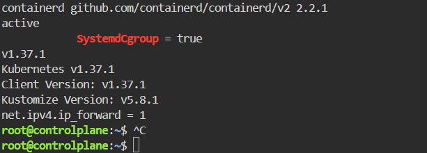
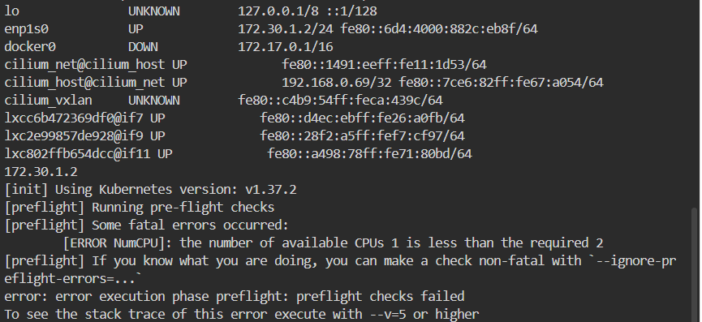
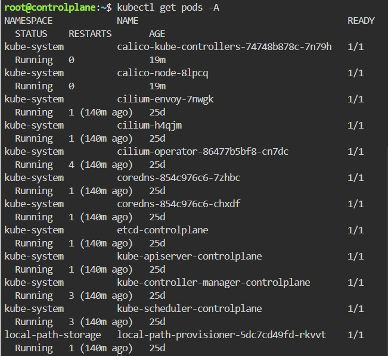

# Lab 9: Deploy a Kubernetes Cluster Using Kubeadm

## Objective
Create a two-node Kubernetes cluster with kubeadm, containerd and the Calico CNI plugin.

## Environment

| Item | Value |
|---|---|
| Platform | Killercoda two-node Kubernetes playground |
| Nodes | `controlplane` (control plane), `node01` (worker) |
| Container runtime | containerd 2.2.1 |
| Kubernetes | v1.37.1 |
| CNI | Calico v3.32.1 |
| Pod network | `10.244.0.0/16` |

## Steps

**1. Verify containerd, kubeadm, kubelet and kubectl (both nodes)**
```bash
containerd --version
systemctl is-active containerd
grep SystemdCgroup /etc/containerd/config.toml
kubeadm version -o short
kubelet --version
kubectl version --client
swapon --show
sysctl net.ipv4.ip_forward
```
containerd is running with `SystemdCgroup = true`, swap is off, and IP forwarding is enabled.



**2. Reset the existing cluster (both nodes)**
```bash
kubeadm reset -f
rm -rf /etc/cni/net.d $HOME/.kube
```

**3. Initialize the control plane**
```bash
kubeadm init \
  --apiserver-advertise-address=172.30.1.2 \
  --pod-network-cidr=10.244.0.0/16 \
  --kubernetes-version=$(kubeadm version -o short) \
  --ignore-preflight-errors=NumCPU
```


**4. Configure kubectl**
```bash
mkdir -p $HOME/.kube
cp -i /etc/kubernetes/admin.conf $HOME/.kube/config
kubectl get nodes
```

**5. Install the Calico CNI plugin**
```bash
curl -O https://raw.githubusercontent.com/projectcalico/calico/v3.32.1/manifests/calico.yaml
sed -i 's|# - name: CALICO_IPV4POOL_CIDR|- name: CALICO_IPV4POOL_CIDR|; s|#   value: "192.168.0.0/16"|  value: "10.244.0.0/16"|' calico.yaml
kubectl apply -f calico.yaml
```

**6. Join the worker node**

On `controlplane`:
```bash
kubeadm token create --print-join-command
```
Run the printed command on `node01`.

## Verification
```bash
kubectl get nodes -o wide
kubectl get pods -A
kubectl get --raw='/readyz?verbose' | tail -3
```
Both nodes are `Ready`, and the control plane and Calico pods are `Running`.




## Notes
- The Killercoda nodes already had containerd, kubeadm, kubelet and kubectl installed, so they were verified instead of installed. The existing cluster was reset and recreated with `kubeadm init` and `kubeadm join`.
- `NumCPU` was ignored in the preflight checks because the playground node has 1 CPU (kubeadm asks for 2).
- The pod network is `10.244.0.0/16` so it does not overlap the node network or the old Cilium range.
- The leftover Cilium network interfaces and iptables rules were removed before initializing.
- Playground sessions are temporary and reset after about an hour.
